

<picture>
  <source media="(prefers-color-scheme: dark)" srcset="./assets/hero/kmos-hero-dark.png" />
  <source media="(prefers-color-scheme: light)" srcset="./assets/hero/kmos-hero-light.png" />
  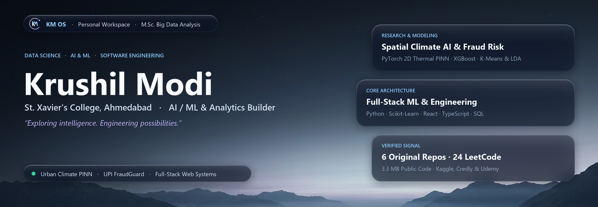
</picture>

  

<b>Workspace:</b>
<a href="#km-os">Home</a> ·
<a href="#data-studio">Data&nbsp;Studio</a> ·
<a href="#intelligence-lab">Intelligence&nbsp;Lab</a> ·
<a href="#dev-workspace">Dev&nbsp;Workspace</a> ·
<a href="#academic-journey">Academic&nbsp;Journey</a> ·
<a href="#activity-center">Activity&nbsp;Center</a> ·
<a href="#connect">Connect</a>

<b>Direct Links:</b>
<a href="https://krushilmodi.netlify.app">Portfolio&nbsp;↗</a> ·
<a href="https://docs.google.com/document/d/1ngGxkqG3lVIJSdmdA-Il-TCNrzacTAon/export?format=pdf">Resume&nbsp;(PDF)&nbsp;↗</a> ·
<a href="https://www.linkedin.com/in/krushil-modi-803037268/">LinkedIn&nbsp;↗</a> ·
<a href="https://leetcode.com/u/krushilModi/">LeetCode&nbsp;@krushilModi&nbsp;↗</a>

---

> **KM OS** is a personal digital workspace presenting the analytical, machine learning, and software engineering work of **Krushil Modi** — **M.Sc. Big Data Analysis** student at **St. Xavier's College, Ahmedabad** (`B.C.A.` graduate). Built around calm clarity and verified evidence: every chart, live interface capture, and metric below comes directly from public repositories and reproducible runs.

---

<picture>
  <source media="(prefers-color-scheme: dark)" srcset="./assets/modules/data-studio-dark.svg" />
  <source media="(prefers-color-scheme: light)" srcset="./assets/modules/data-studio-light.svg" />
  
</picture>

### 01 · Flagship Research — Ahmedabad Urban Heat Mitigation &amp; Thermal PINN

**Repository:** [`Krushilmodi1/urban_heat_mitigation`](https://github.com/Krushilmodi1/urban_heat_mitigation) · `Python` · `PyTorch` · `GeoPandas` · `Leaflet` · `Chart.js`

A 1 km × 1 km spatial decision-support system covering **1,661 grid cells (1,570 km²)** across Ahmedabad, integrating calibrated daytime Land Surface Temperature (`LST`, baseline `32.08 °C`) with building footprint proxies (`4,777` footprints) and a PyTorch **Physics-Informed Neural Network (`PINN`)** regularized by a simplified 2D thermal PDE (`λ_pde = 0.1`, reducing PDE residual MSE by **22.2%** from `0.962` to `0.748`).

  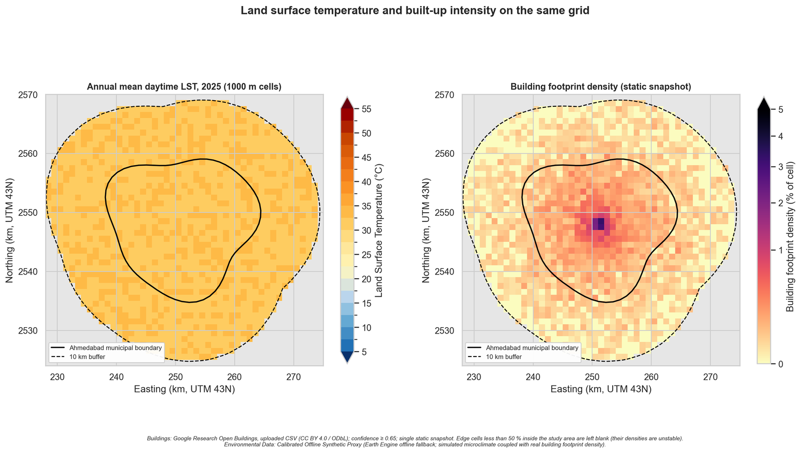

<table width="100%">
  <tr>
    <td width="50%" valign="top">
      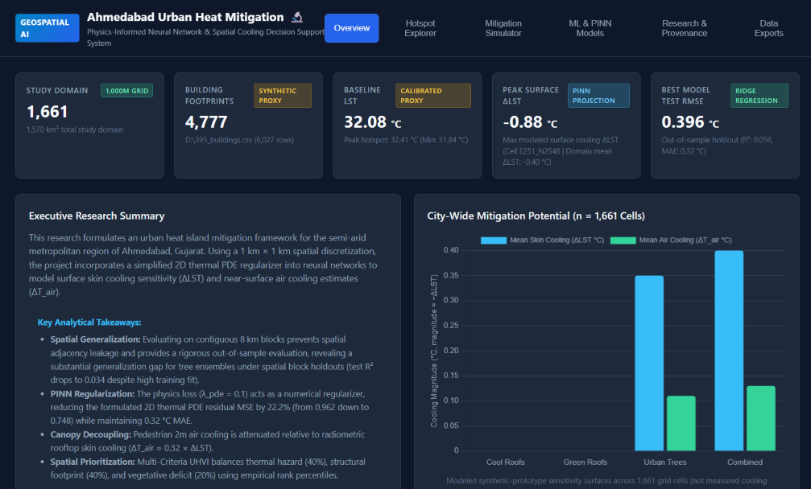
      
<b>Research Decision Dashboard</b> · Domain KPIs (<code>1,661</code> cells, <code>32.08 °C</code> baseline LST, <code>-0.88 °C</code> peak modeled surface cooling ΔLST, <code>0.396 °C</code> RMSE).

    </td>
    <td width="50%" valign="top">
      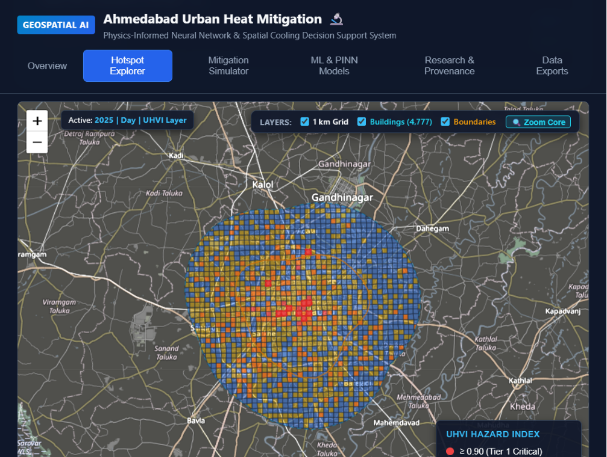
      
<b>Interactive Spatial Explorer</b> · Multi-Criteria UHVI prioritization layer across Ahmedabad &amp; 10 km peripheral buffer.

    </td>
  </tr>
</table>

<b>Spatial Holdout Benchmark &amp; Scientific Notes</b> (8 km contiguous block validation, ntest = 780)

- Evaluated strictly on **contiguous 8 km spatial blocks** to eliminate spatial adjacency leakage (`Moran's I = -0.006`, `p = 0.44` indicating near-zero residual spatial autocorrelation at evaluation scale).
- **Holdout Benchmark (`RMSE` / `R²`)**: **Ridge Regression** (`0.396 °C` / `0.056 R²`) outperformed **Random Forest** (`0.401 °C` / `0.034`), **Deep MLP (No PDE)** (`0.399 °C` / `0.041`), and **Urban Heat PINN** (`0.405 °C` / `0.014`), where narrow synthetic target variance (`σ = 0.407 °C`) and sparse building coverage constrained raw R² while physics regularization enforced smoother spatial thermal gradients.
- All prototype proxy surfaces and cooling projections (`mean ΔLST = -0.40 °C`, canopy `ΔT_air ≈ 0.32 × ΔLST`) are explicitly documented as **modeled sensitivity outputs**, not physical in-situ temperature measurements.

---

### 02 · Behavioral &amp; Statistical Analytics — Short-Form Video Impact Study

**Repository:** [`Krushilmodi1/Impact-of-shortform_video`](https://github.com/Krushilmodi1/Impact-of-shortform_video) · `Jupyter Notebook` · `SciPy` · `Scikit-Learn` · `K-Means` · `LDA`

Multivariate statistical and machine learning investigation across **207 student survey responses (`29` features)** analyzing how short-form video consumption habits, attention fragmentation, and cognitive load correlate with academic `GPA`.

<table width="100%">
  <tr>
    <td width="50%" valign="top">
      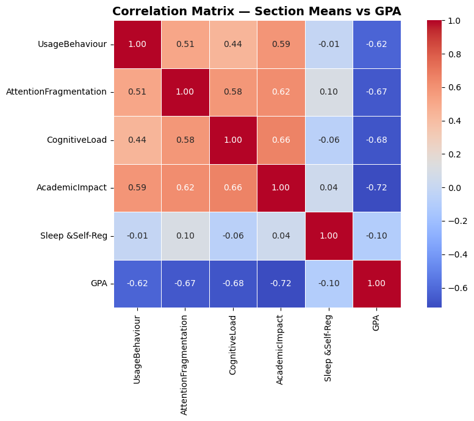
      
<b>Pearson Correlation Matrix</b> · Academic Impact (<code>r = -0.72</code>), Cognitive Load (<code>-0.68</code>), and Attention Fragmentation (<code>-0.67</code>) strongly invert with GPA.

    </td>
    <td width="50%" valign="top">
      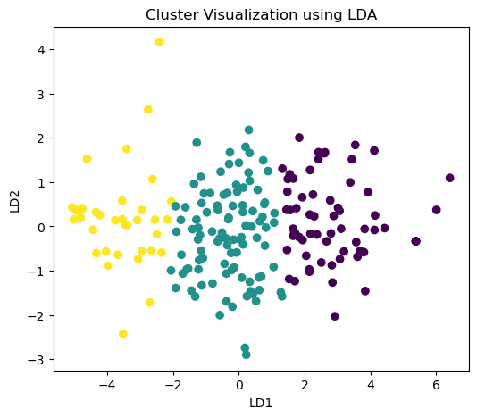
      
<b>Cluster Visualization (K-Means + LDA)</b> · Three distinct student behavioral engagement personas projected cleanly across discriminant axes.

    </td>
  </tr>
</table>

<b>Inspect Regression Model Comparison</b> (Random Forest R² = 0.7942, RMSE = 0.4348)

 

  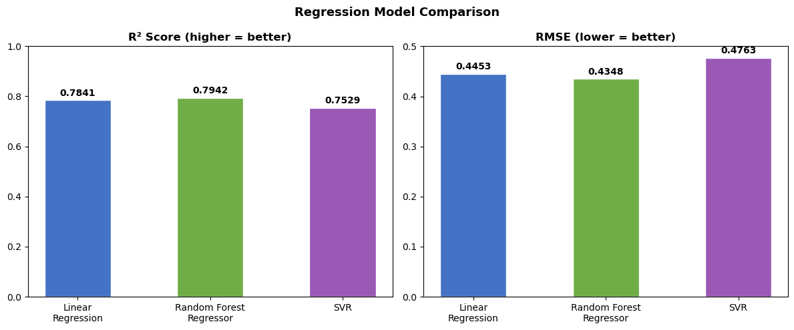

- Benchmarked **Random Forest Regressor** (`R² = 0.7942`, `RMSE = 0.4348`) against **Linear Regression** (`0.7841` / `0.4453`) and **SVR** (`0.7529` / `0.4763`).

---

<picture>
  <source media="(prefers-color-scheme: dark)" srcset="./assets/modules/intelligence-lab-dark.svg" />
  <source media="(prefers-color-scheme: light)" srcset="./assets/modules/intelligence-lab-light.svg" />
  
</picture>

### AI-Powered UPI Cyber Fraud Detection (`FraudGuard`)

**Repository:** [`Krushilmodi1/upi-fraud-detection`](https://github.com/Krushilmodi1/upi-fraud-detection) · **Live App:** [`upi-frauddetection.netlify.app ↗`](https://upi-frauddetection.netlify.app/) · `XGBoost` · `Random Forest` · `React` · `Python API`

End-to-end financial risk pipeline analyzing **26,393 UPI transactions**, comparing classical and gradient-boosted ensembles paired with a real-time scoring web application and alert guidance flow.

<table width="100%">
  <tr>
    <td width="52%" valign="top">
      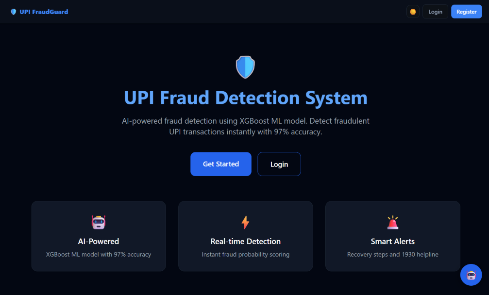
      
<b>Live Deployed Interface</b> · Real-time risk scoring UX with instant probability output &amp; 1930 cyber-helpline recovery flow.

    </td>
    <td width="48%" valign="top">
      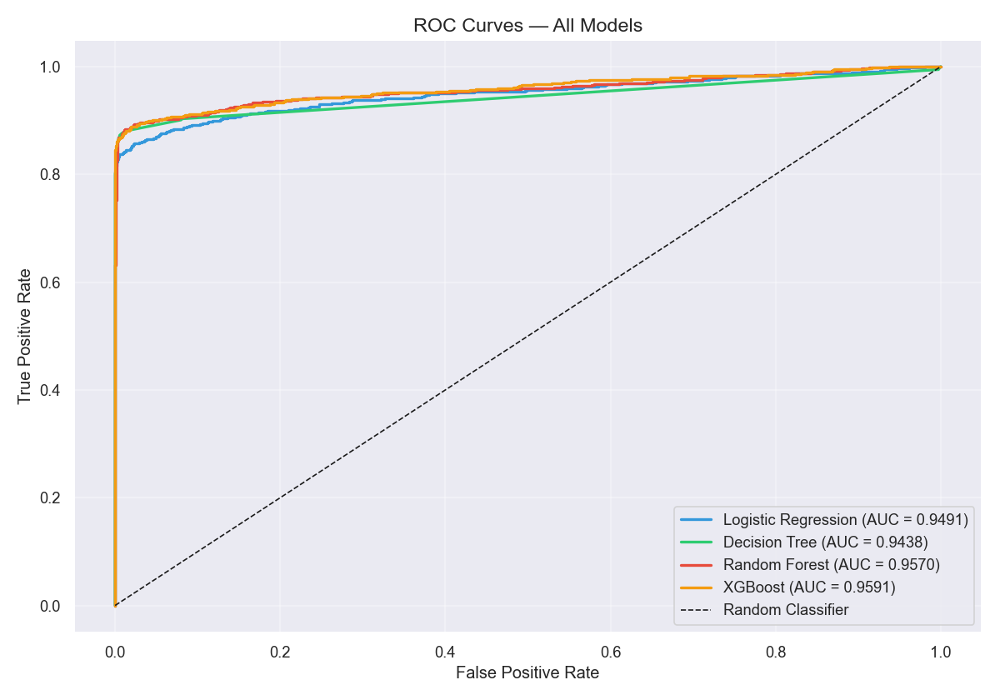
      
<b>Model ROC-AUC Comparison</b> · XGBoost (<code>0.9591</code> AUC), Random Forest (<code>0.9570</code> AUC, <code>0.9129</code> F1), Logistic Regression (<code>0.9491</code>), Decision Tree (<code>0.9438</code>).

    </td>
  </tr>
</table>

<b>Inspect Top 20 Engineered Fraud Signals</b> (XGBoost Feature Importance)

 

  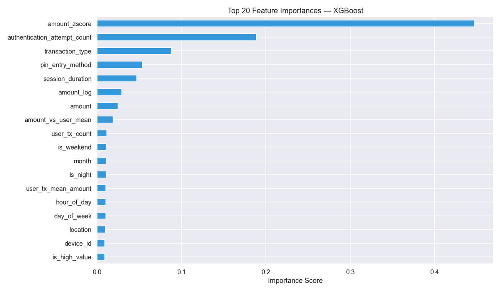

- Primary predictive signals: `amount_zscore`, `authentication_attempt_count`, `transaction_type`, `pin_entry_method`, `session_duration`, and user baseline deviation (`amount_vs_user_mean`).

---

<picture>
  <source media="(prefers-color-scheme: dark)" srcset="./assets/modules/dev-workspace-dark.svg" />
  <source media="(prefers-color-scheme: light)" srcset="./assets/modules/dev-workspace-light.svg" />
  
</picture>

<table width="100%">
  <tr>
    <td width="50%" valign="top">
      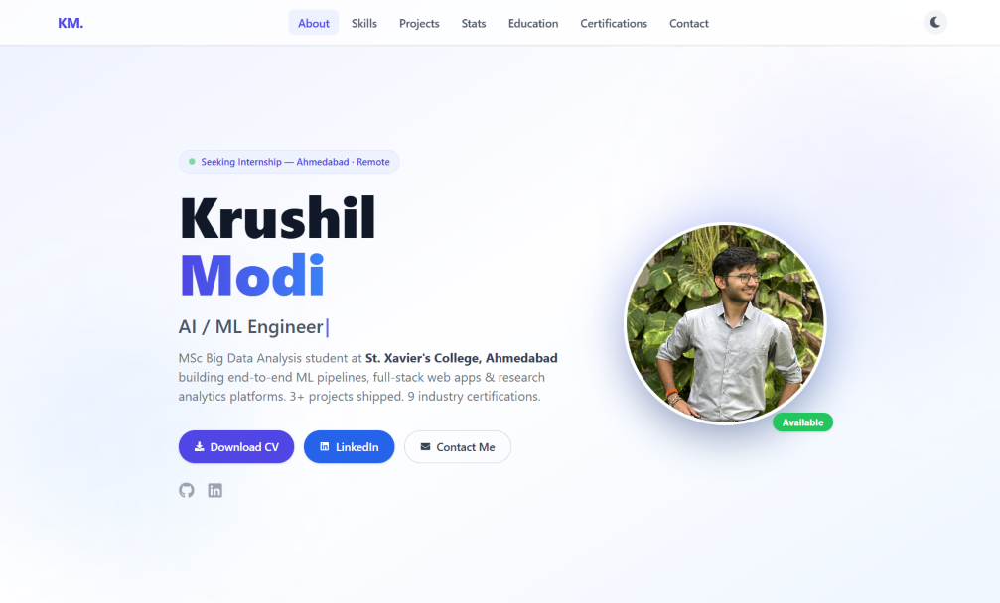
      
<b>Live Developer Portfolio</b> · <a href="https://krushilmodi.netlify.app/">krushilmodi.netlify.app&nbsp;↗</a>

    </td>
    <td width="50%" valign="middle">
      <h4>Full-Stack &amp; Engineering Builds</h4>
      
<b><a href="https://github.com/Krushilmodi1/real-estate-marketplace">Nestory Real Estate Marketplace</a></b> · <code>TypeScript</code> · <code>React 18</code> · <code>Vite</code> · <code>Tailwind</code> · <code>shadcn/ui</code> · <code>Supabase</code> · <code>Google Maps</code> 
      Property discovery platform featuring interactive map search and Recharts analytics (<code>369.9 KB</code> typed codebase in <code>nestory-marketplace-main</code>).

      
<b><a href="https://github.com/Krushilmodi1/portfolio">Developer Portfolio</a></b> · <code>JavaScript</code> · <code>HTML5</code> · <code>CSS3</code> · <code>Netlify</code> 
      Live personal engineering showcase highlighting verified research builds, credentials, and skill modules.

      
<b><a href="https://github.com/Krushilmodi1/CodeAlpha_tasks">CodeAlpha Python Tasks</a></b> · <code>Python</code> 
      Structured algorithmic scripting utilities and CLI exercises.

    </td>
  </tr>
</table>

---

<picture>
  <source media="(prefers-color-scheme: dark)" srcset="./assets/modules/academic-journey-dark.svg" />
  <source media="(prefers-color-scheme: light)" srcset="./assets/modules/academic-journey-light.svg" />
  
</picture>

  

<picture>
  <source media="(prefers-color-scheme: dark)" srcset="./assets/education/academic-journey-dark.svg" />
  <source media="(prefers-color-scheme: light)" srcset="./assets/education/academic-journey-light.svg" />
  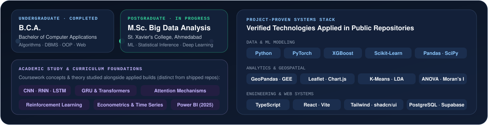
</picture>

<b>Verified Certifications &amp; Workshops</b> (Kaggle, Credly, Udemy &amp; Power BI)

- **Kaggle** · [Intro to Machine Learning](https://www.kaggle.com/learn/certification/krushilmodi19/intro-to-machine-learning) · [Feature Engineering](https://www.kaggle.com/learn/certification/krushilmodi19/feature-engineering) · [Data Cleaning](https://www.kaggle.com/learn/certification/krushilmodi19/data-cleaning)
- **Credly** · [Verified Digital Badge](https://www.credly.com/badges/3d8cc920-458c-4077-9ea9-cd39209c548b/linked_in_profile)
- **Udemy** · [UML — Complete Guide](https://www.udemy.com/certificate/UC-f787606c-c355-4313-96a0-a04b4a8f88f3/) · [C and C++ Programming](https://www.udemy.com/certificate/UC-31321bd5-1f96-409b-beea-b653c3fb3640/)
- **Power BI Workshop** · Data Modeling &amp; Executive BI Reporting (`Apr 2025`)

---

<picture>
  <source media="(prefers-color-scheme: dark)" srcset="./assets/modules/activity-center-dark.svg" />
  <source media="(prefers-color-scheme: light)" srcset="./assets/modules/activity-center-light.svg" />
  
</picture>

  

<picture>
  <source media="(prefers-color-scheme: dark)" srcset="./assets/analytics/github-activity-dark.svg" />
  <source media="(prefers-color-scheme: light)" srcset="./assets/analytics/github-activity-light.svg" />
  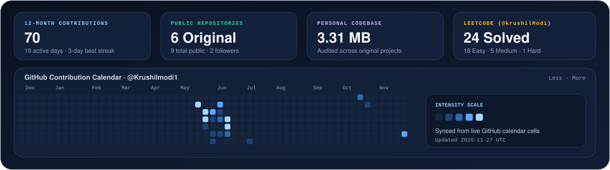
</picture>

  

<picture>
  <source media="(prefers-color-scheme: dark)" srcset="./assets/analytics/language-distribution-dark.svg" />
  <source media="(prefers-color-scheme: light)" srcset="./assets/analytics/language-distribution-light.svg" />
  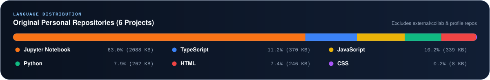
</picture>

---

### Connect &amp; Collaborate

Open to **Data Science, Machine Learning, Analytics, and Software Engineering** internships, research collaborations, and applied system builds.

<a href="https://krushilmodi.netlify.app"><b>Portfolio</b></a> ·
<a href="https://docs.google.com/document/d/1ngGxkqG3lVIJSdmdA-Il-TCNrzacTAon/export?format=pdf"><b>Download&nbsp;Resume&nbsp;(PDF)</b></a> ·
<a href="https://www.linkedin.com/in/krushil-modi-803037268/"><b>LinkedIn</b></a> ·
<a href="https://leetcode.com/u/krushilModi/"><b>LeetCode&nbsp;@krushilModi</b></a> ·
<a href="mailto:krushilmodi1234@gmail.com"><code>krushilmodi1234@gmail.com</code></a>

 

<picture>
  <source media="(prefers-color-scheme: dark)" srcset="./assets/hero/kmos-footer-dark.png" />
  <source media="(prefers-color-scheme: light)" srcset="./assets/hero/kmos-footer-light.png" />
  
</picture>

