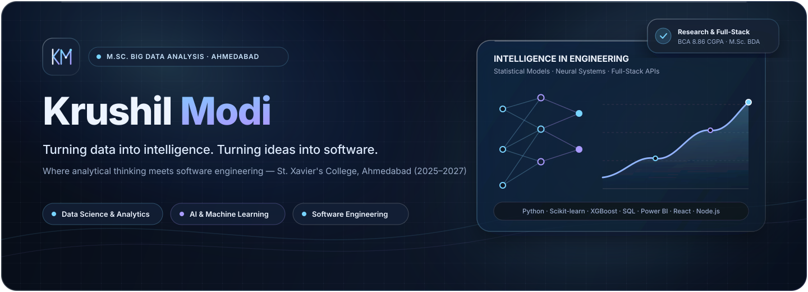
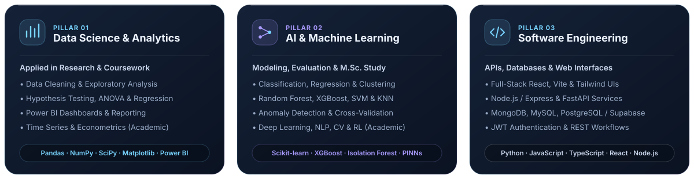
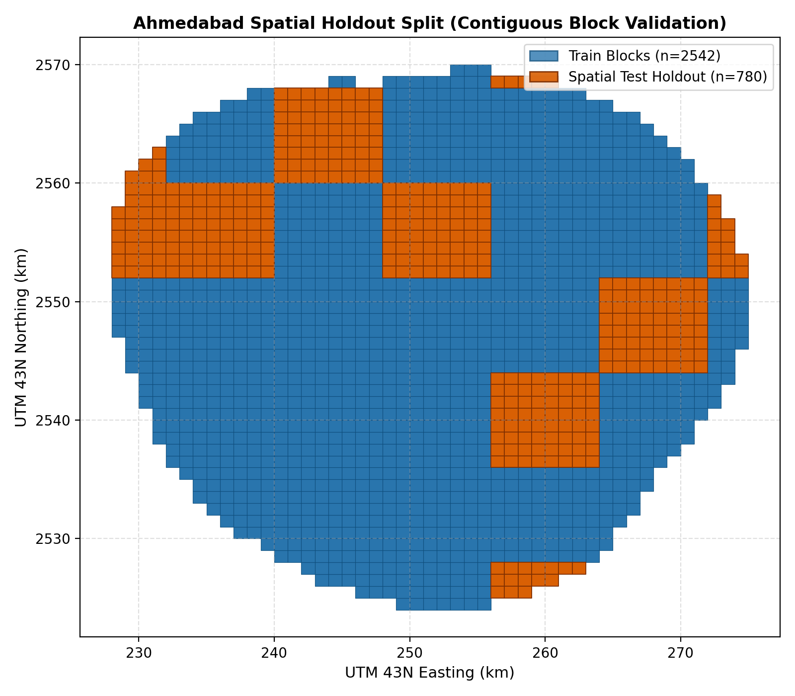
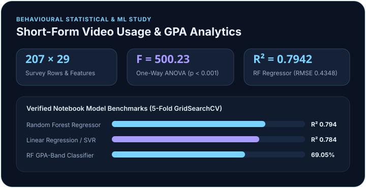
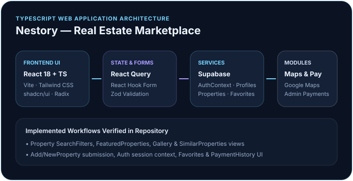
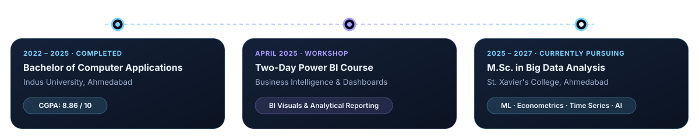
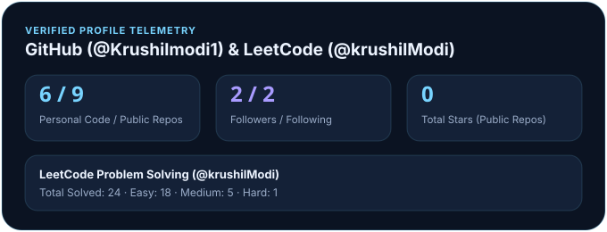

<a href="#featured-projects">
  <picture>
    <source media="(prefers-color-scheme: dark)" srcset="assets/branding/hero-dark.svg" />
    <source media="(prefers-color-scheme: light)" srcset="assets/branding/hero-light.svg" />
    
  </picture>
</a>

 
 

  
  
  
  
  

  <a href="#about">About</a> &bull;
  <a href="#core-domains">Core Domains</a> &bull;
  <a href="#featured-projects">Featured Projects</a> &bull;
  <a href="#technology-ecosystem">Tech Ecosystem</a> &bull;
  <a href="#academic-journey">Education</a> &bull;
  <a href="#github-and-leetcode-activity">Analytics</a> &bull;
  <a href="#connect">Contact</a>

---

## About

I'm a postgraduate student pursuing an **M.Sc. in Big Data Analysis** at **St. Xavier's College, Ahmedabad** (`2025–2027`), building on a **Bachelor of Computer Applications (BCA)** from **Indus University, Ahmedabad** (`8.86 / 10` CGPA).

My academic work and personal projects sit at the intersection of **Data Science**, **AI & Machine Learning**, and **Software Engineering**—turning raw behavioral, financial, and spatial datasets into statistical models, predictive pipelines, and full-stack web interfaces.

- **Target Opportunity Interests:** Data Analyst, Junior AI / ML Engineer, Data Science, Business Intelligence, and Full-Stack / Backend Software Developer roles.
- **Current Exploration:** Physics-informed spatial modeling, time series forecasting, econometrics, deep learning architectures, and Business Intelligence dashboards.
- **Beyond Code:** Outside technical problem-solving, I explore creative storytelling through original music and songwriting.

---

## Core Domains

  <picture>
    <source media="(prefers-color-scheme: dark)" srcset="assets/sections/identity-dark.svg" />
    <source media="(prefers-color-scheme: light)" srcset="assets/sections/identity-light.svg" />
    
  </picture>

---

## Featured Projects

Selected personal repositories verified directly against source code, notebooks, and live deployments.

### 1. AI-Powered UPI Cyber Fraud Detection System (`upi-fraud-detection`)

> Full-stack fraud risk analysis platform pairing an XGBoost & Isolation Forest ML pipeline with a REST API microservice and React analytics dashboard.

<table>
  <tr>
    <td width="48%" valign="top">
      
    </td>
    <td width="52%" valign="top">
      <ul>
        <li><strong>Problem:</strong> Identifying suspicious Indian UPI transactions in imbalanced payment streams while giving users a guided reporting flow.</li>
        <li><strong>Approach:</strong> Evaluated four supervised classifiers alongside Isolation Forest anomaly scoring across <code>26,393</code> transaction records in Jupyter Notebook.</li>
        <li><strong>Implementation:</strong> Served predictions through a Python FastAPI service integrated with Node.js / Express, MongoDB Atlas, JWT + bcryptjs auth, Recharts analytics, complaint workflows, and a multilingual chatbot (English, Hindi, Gujarati).</li>
        <li><strong>Verified Outcome:</strong> XGBoost achieved <code>97.04%</code> accuracy, <code>0.9591</code> ROC-AUC, and <code>91.02%</code> F1 score in notebook evaluation, deployed live for interactive inspection.</li>
      </ul>
      

        <code>Python</code> <code>XGBoost</code> <code>FastAPI</code> <code>React 19</code> <code>Node.js</code> <code>MongoDB</code> <code>Tailwind CSS</code>
      

      

        <a href="https://github.com/Krushilmodi1/upi-fraud-detection"><strong>Repository</strong></a> &nbsp;|&nbsp;
        <a href="https://upi-frauddetection.netlify.app/"><strong>Live Demo</strong></a>
      

    </td>
  </tr>
</table>

---

### 2. Ahmedabad Urban Heat Mitigation & Cooling Simulation (`urban_heat_mitigation`)

> Spatial climate analytics pipeline combining satellite thermal indices, building footprints, Physics-Informed Neural Networks, and cooling scenario simulations for Ahmedabad.

<table>
  <tr>
    <td width="48%" valign="top">
      
    </td>
    <td width="52%" valign="top">
      <ul>
        <li><strong>Problem:</strong> Studying urban heat island distribution across Ahmedabad municipal limits and a 10 km outward buffer using repeatable spatial validation.</li>
        <li><strong>Approach:</strong> Fused Landsat 8 &amp; 9 Land Surface Temperature (LST), NDVI, and NDBI observations with chunked Open Buildings polygons on a 1 km UTM 43N grid (<code>EPSG:32643</code>).</li>
        <li><strong>Implementation:</strong> Built a staged Python pipeline (<code>boundary</code> &rarr; <code>extract</code> &rarr; <code>buildings</code> &rarr; <code>grid</code> &rarr; <code>plots</code> &rarr; <code>pinn</code> &rarr; <code>simulation</code>) with spatial block holdout testing (2,542 train / 780 test cells), 2D thermal diffusion-advection PINN training, cooling scenarios (cool roofs, green roofs, urban trees), and an offline unit test suite.</li>
        <li><strong>Verified Deliverable:</strong> End-to-end reproducible geospatial framework with automated cloud-masking, missing-month handling, and HTML/PNG diagnostic outputs.</li>
      </ul>
      

        <code>Python</code> <code>Geospatial Grid</code> <code>Earth Engine</code> <code>PINNs</code> <code>NumPy</code> <code>Pandas</code> <code>Unittest</code>
      

      

        <a href="https://github.com/Krushilmodi1/urban_heat_mitigation"><strong>Repository</strong></a>
      

    </td>
  </tr>
</table>

---

### 3. Impact of Short-Form Video Usage on Academic Performance (`Impact-of-shortform_video`)

> Quantitative statistical and machine learning investigation examining behavioral short-form video patterns and student GPA outcomes.

<table>
  <tr>
    <td width="48%" valign="top">
      <a href="https://github.com/Krushilmodi1/Impact-of-shortform_video">
        <picture>
          <source media="(prefers-color-scheme: dark)" srcset="assets/projects/shortform-cover-dark.svg" />
          <source media="(prefers-color-scheme: light)" srcset="assets/projects/shortform-cover-light.svg" />
          
        </picture>
      </a>
    </td>
    <td width="52%" valign="top">
      <ul>
        <li><strong>Problem:</strong> Evaluating whether daily short-form video habits, cognitive load, and sleep self-regulation correlate with differences in university GPA.</li>
        <li><strong>Approach:</strong> Reverse-coded positive psychometric survey items across <code>207</code> observations (<code>29</code> features), engineered five behavioral section means, and applied K-Means clustering (<code>k=3</code> via Elbow Method) with LDA projection.</li>
        <li><strong>Implementation:</strong> Ran One-Way &amp; Two-Way ANOVA in Python alongside Linear Regression, SVR, Random Forest Regressor, Logistic Regression, and Random Forest Classifier tuned with 5-fold <code>GridSearchCV</code>.</li>
        <li><strong>Verified Findings (Observational):</strong> Statistically significant GPA variance across behavioral clusters (<code>F = 500.23, p &lt; 0.001</code>) and usage levels (<code>F = 11.75, p &lt; 0.001</code>); Random Forest achieved <code>R&sup2; = 0.7942</code> (regression) and <code>69.05%</code> (GPA-band classification).</li>
      </ul>
      

        <code>Python</code> <code>Pandas</code> <code>Scikit-learn</code> <code>SciPy ANOVA</code> <code>K-Means</code> <code>Random Forest</code> <code>Jupyter</code>
      

      

        <a href="https://github.com/Krushilmodi1/Impact-of-shortform_video"><strong>Repository</strong></a>
      

    </td>
  </tr>
</table>

---

### 4. Nestory — Real Estate Marketplace (`real-estate-marketplace`)

> TypeScript and React property discovery application featuring Google Maps integration, authenticated buyer/agent workflows, favorites, and payment history UI.

<table>
  <tr>
    <td width="48%" valign="top">
      <a href="https://github.com/Krushilmodi1/real-estate-marketplace">
        <picture>
          <source media="(prefers-color-scheme: dark)" srcset="assets/projects/real-estate-cover-dark.svg" />
          <source media="(prefers-color-scheme: light)" srcset="assets/projects/real-estate-cover-light.svg" />
          
        </picture>
      </a>
    </td>
    <td width="52%" valign="top">
      <ul>
        <li><strong>Problem:</strong> Structuring multi-view property search, media galleries, agent inquiries, and account state cleanly in a typed frontend.</li>
        <li><strong>Approach:</strong> Built modular TypeScript views using React 18, shadcn/ui (Radix primitives), TanStack React Query, React Hook Form, and Zod validation backed by Supabase auth and data services.</li>
        <li><strong>Implementation:</strong> Includes <code>SearchFilters</code>, <code>PropertyDetail</code> galleries, Google Maps views (<code>@react-google-maps/api</code>), <code>AddProperty</code> forms, favorites tracking, and <code>PaymentModal</code> / <code>AdminPayments</code> UI components.</li>
        <li><strong>Verified Deliverable:</strong> Complete typed multi-page React application repository.</li>
      </ul>
      

        <code>TypeScript</code> <code>React 18</code> <code>Vite</code> <code>Tailwind CSS</code> <code>shadcn/ui</code> <code>Supabase</code> <code>Google Maps API</code>
      

      

        <a href="https://github.com/Krushilmodi1/real-estate-marketplace"><strong>Repository</strong></a>
      

    </td>
  </tr>
</table>

<strong>Additional Personal Repositories &amp; Learning Index</strong>

 

| Repository | Purpose &amp; Verified Stack | Link |
| :--- | :--- | :--- |
| **Personal Developer Portfolio** | React, Vite, Tailwind CSS, responsive sections, Web3Forms contact &amp; JSON-LD SEO metadata | [portfolio](https://github.com/Krushilmodi1/portfolio) &middot; [Live Site](https://krushilmodi.netlify.app) |
| **CodeAlpha ML &amp; Data Tasks** | Python exercises covering Iris KNN classification, Unemployment in India EDA, and Car Price Linear Regression | [CodeAlpha_tasks](https://github.com/Krushilmodi1/CodeAlpha_tasks) |

Note: Collaborator or friend-owned repositories visible on GitHub (such as <code>Finance-hub</code>) belong to their respective authors and are not presented here as personal projects.

---

## Technology Ecosystem

Technologies are grouped by practical context—distinguishing tools demonstrated inside public codebases from academic coursework and active exploration (no arbitrary skill percentages).

| Domain | Demonstrated in Public Repositories | Academic Coursework &amp; Active Learning |
| :--- | :--- | :--- |
| **Languages** | `Python`, `JavaScript`, `TypeScript`, `HTML5`, `CSS3`, `SQL` | `Java`, `PHP`, `C`, `C++` (foundational coursework &amp; certifications) |
| **Data Science &amp; ML** | `Pandas`, `NumPy`, `Scikit-learn`, `XGBoost`, `SciPy`, `Matplotlib`, `Seaborn`, `Jupyter`, `PINNs` | Econometrics, Time Series Forecasting, Deep Learning (`CNN`/`RNN`/`LSTM`), NLP, Computer Vision, Reinforcement Learning |
| **Business Intelligence** | Interactive visual reporting &amp; analytics workflows | **Microsoft Power BI** (completed two-day workshop in April 2025 covering dashboards, data transformation &amp; BI storytelling) |
| **Backend &amp; APIs** | `Node.js`, `Express.js`, `FastAPI`, `REST APIs`, `JWT`, `Supabase Auth` | `Django`, relational schema modeling &amp; authentication patterns |
| **Frontend &amp; Databases** | `React`, `Vite`, `Tailwind CSS`, `shadcn/ui`, `Recharts`, `MongoDB` | `MySQL`, responsive design &amp; UI architecture |
| **Tools &amp; Platforms** | `Git`, `GitHub`, `VS Code`, `Netlify`, `Postman` | `Streamlit`, `Render`, spatial &amp; statistical notebooks |

---

## Academic Journey

  <picture>
    <source media="(prefers-color-scheme: dark)" srcset="assets/sections/timeline-dark.svg" />
    <source media="(prefers-color-scheme: light)" srcset="assets/sections/timeline-light.svg" />
    
  </picture>

<strong>Academic Knowledge Focus &amp; Verified Certificates</strong>

 

**Current Academic &amp; Research Study Areas (M.Sc. Big Data Analysis):**
- **Statistical Intelligence:** Hypothesis testing, ANOVA, multiple regression, econometrics, time series analysis, and forecasting.
- **Machine Intelligence:** Supervised/unsupervised learning, anomaly detection, neural networks, NLP, computer vision, and reinforcement learning concepts.
- **Data Intelligence &amp; BI:** Big data preprocessing, spatial grid aggregation, visual storytelling, and Business Intelligence reporting.

**Verified Public Certificates (Linked from Portfolio):**
- [Intro to Machine Learning — Kaggle](https://www.kaggle.com/learn/certification/krushilmodi19/intro-to-machine-learning)
- [Feature Engineering — Kaggle](https://www.kaggle.com/learn/certification/krushilmodi19/feature-engineering)
- [Data Cleaning — Kaggle](https://www.kaggle.com/learn/certification/krushilmodi19/data-cleaning)
- [Credly Verified Credential](https://www.credly.com/badges/3d8cc920-458c-4077-9ea9-cd39209c548b/public_url)
- [C and C++ Programming — Udemy](https://www.udemy.com/certificate/UC-31321bd5-c7ba-4e8b-9ac7-d94a4c3d2401/) &middot; [UML Complete Guide — Udemy](https://www.udemy.com/certificate/UC-f787606c-c5aa-4cb3-8b82-b598557c5fc6/)
- Two-Day **Microsoft Power BI** Course (April 2025 — workshop completion)

---

## GitHub and LeetCode Activity

Generated cleanly from verified public GitHub (`@Krushilmodi1`) and LeetCode (`@krushilModi`) profiles so light and dark themes render reliably without broken external widgets.

  <table>
    <tr>
      <td width="50%" align="center">
        <picture>
          <source media="(prefers-color-scheme: dark)" srcset="assets/analytics/github-overview-dark.svg" />
          <source media="(prefers-color-scheme: light)" srcset="assets/analytics/github-overview-light.svg" />
          
        </picture>
      </td>
      <td width="50%" align="center">
        <picture>
          <source media="(prefers-color-scheme: dark)" srcset="assets/analytics/language-distribution-dark.svg" />
          <source media="(prefers-color-scheme: light)" srcset="assets/analytics/language-distribution-light.svg" />
          
        </picture>
      </td>
    </tr>
  </table>

Language percentages represent raw byte counts across Krushil's own public code repositories (excluding forks and collaborator repos)—they reflect codebase composition rather than personal skill level.

<strong>Live External GitHub Streak &amp; LeetCode Card</strong>

 

  <picture>
    <source media="(prefers-color-scheme: dark)" srcset="https://streak-stats.demolab.com?user=Krushilmodi1&amp;background=0B1322&amp;border=1E3354&amp;stroke=78D4FF&amp;ring=78D4FF&amp;fire=A99BFF&amp;currStreakNum=EDF4FF&amp;sideNums=EDF4FF&amp;currStreakLabel=78D4FF&amp;sideLabels=9CAECA&amp;dates=9CAECA" />
    <source media="(prefers-color-scheme: light)" srcset="https://streak-stats.demolab.com?user=Krushilmodi1&amp;background=FFFFFF&amp;border=D7E2F2&amp;stroke=2563EB&amp;ring=2563EB&amp;fire=6554C0&amp;currStreakNum=17243A&amp;sideNums=17243A&amp;currStreakLabel=2563EB&amp;sideLabels=52627A&amp;dates=52627A" />
    
  </picture>
  <picture>
    <source media="(prefers-color-scheme: dark)" srcset="https://leetcard.jacoblin.cool/krushilModi?theme=dark&amp;font=Inter&amp;ext=contest" />
    <source media="(prefers-color-scheme: light)" srcset="https://leetcard.jacoblin.cool/krushilModi?theme=light&amp;font=Inter&amp;ext=contest" />
    
  </picture>

---

## Connect

Open to connecting on data science research, analytical engineering, software builds, and learning opportunities.

| Channel | Destination |
| :--- | :--- |
| **Portfolio** | [krushilmodi.netlify.app](https://krushilmodi.netlify.app) |
| **Resume / CV** | [Download Resume (PDF)](https://docs.google.com/document/d/1ngGxkqG3lVIJSdmdA-Il-TCNrzacTAon/export?format=pdf) |
| **LinkedIn** | [linkedin.com/in/krushil-modi-803037268](https://www.linkedin.com/in/krushil-modi-803037268/) |
| **Email** | [krushilmodi1234@gmail.com](mailto:krushilmodi1234@gmail.com) |
| **GitHub** | [github.com/Krushilmodi1](https://github.com/Krushilmodi1) |
| **LeetCode** | [leetcode.com/u/krushilModi](https://leetcode.com/u/krushilModi/) |

 

  <picture>
    <source media="(prefers-color-scheme: dark)" srcset="assets/branding/footer-dark.svg" />
    <source media="(prefers-color-scheme: light)" srcset="assets/branding/footer-light.svg" />
    
  </picture>

